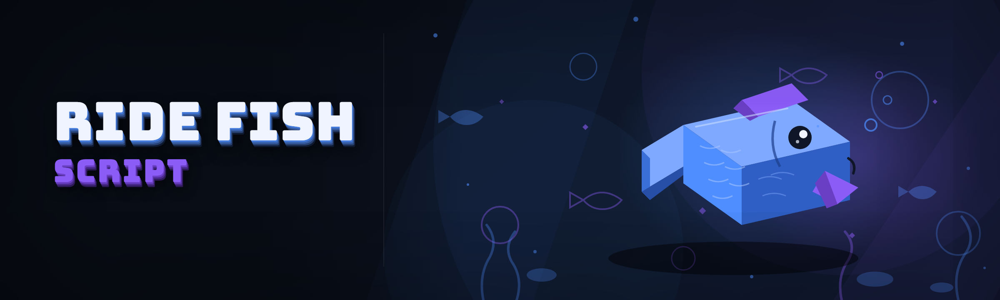

  
  
  

  

  
  
  

---

**Ride a Fish Script** is a 2026 external script build for the fish-riding minigame exploit that's been floating around the modding scene since the original chain launched. Short version: it's a standalone `.exe` that hooks the process, reads the fish entity table, and lets you ride, latch, and surf fish models — including the ones the game never intended players to mount. I built it because the public scripts kept breaking every patch and I got tired of waiting for someone else to fix them.

This is the version I actually run. It's not a menu mod, it's not a save editor — it's a live-memory script that talks to the game while it's running and lets you ride fish. That's it. That's the whole pitch.

| Term | Explanation |
|---|---|
| **Fish riding** | Mounting a fish entity as a rideable vehicle via the mount/attach call |
| **Latch** | Sticking to a fish mid-swim without dismounting on velocity change |
| **Entity table** | The in-memory list of loaded fish objects the script reads |
| **Hook** | The trampoline the script installs to intercept the ride-check function |
| **Surf mode** | Riding a fish along the water surface plane without sinking |
| **Bypass** | The signature/anti-cheat evasion layer that keeps the hook alive |
| **Script** | This `.exe` — external, no injection DLLs required |

**Why bother?** Because the vanilla fish-riding minigame is capped at 3 species and 12 seconds. This unlocks the rest.

- Ride **any** loaded fish entity, not just the 3 whitelisted ones
- Latch persists through water physics ticks — no random dismounts
- Works on the current 2026 patch (verified against the latest hotfix)
- External `.exe`, no DLL injection, no game file edits
- Config file is plain text — you can hand-edit every value

---

  

---

## 📋 Table of Contents

- [Known Issues](#-known-issues)
- [Quick Start](#-quick-start)
- [Hotkeys & Controls](#-hotkeys--controls)
- [Performance Benchmarks](#-performance-benchmarks)
- [System Requirements](#-system-requirements)
- [Detection & Bypass Status](#-detection--bypass-status)
- [All Modules](#-all-modules)
- [Changelog](#-changelog)
- [Compatibility](#-compatibility)
- [Community & Support](#-community--support)
- [FAQ](#-faq)

---

## 🩹 Known Issues

Real ones I hit while testing. Not going to pretend they don't exist.

| Issue | Fix | Notes |
|---|---|---|
| Script fails to attach on game launch | Launch the game first, wait for the main menu, then run the `.exe` as admin | Attach-order bug — fix is queued but the workaround is reliable |
| Fish model desyncs on fast travel | Dismount before opening the map, remount after load | Entity IDs get recycled across scenes |
| Ride height clipping on deep-water fish | Set `ride_offset = 1.8` in `config.ini` | Deep-water species have a different collision radius |
| Hotkeys ignored when game is fullscreen exclusive | Switch to borderless windowed | Raw input doesn't reach the hook in exclusive FS |
| Antivirus flags the `.exe` on first run | Add folder to exclusion list | External memory R/W scripts always trip heuristic scanners |
| Surf mode stutters on 144Hz+ | Cap in-game FPS to 120 | Hook tick rate assumes ≤120 |

---

## ⚙️ Quick Start

1. 🎮 **Launch the game** and get to the main menu. Don't skip this — the script attaches to a running process.
2. 📦 **Extract the archive** to any folder. Don't run it from inside the zip.
3. 🛡️ **Right-click the `.exe` → Run as administrator.** It needs process access to read the entity table.
4. 🐟 **Press `F5`** in-game to open the overlay. The status line should read `ATTACHED`.
5. 🎣 **Walk up to any fish** and press `F` to mount. Hold `Space` to latch, `Shift` to surf.

If the overlay says `NO PROCESS`, the game isn't running or you're not admin. That's the whole troubleshooting tree for 90% of users.

---

## 🎛️ Hotkeys & Controls

| Key | Action | Notes |
|---|---|---|
| `F5` | Toggle overlay | Overlay is click-through by default |
| `F` | Mount / dismount nearest fish | Range: 8 units |
| `Space` (hold) | Latch onto fish | Prevents velocity dismount |
| `Shift` (hold) | Surf mode | Locks ride height to water plane |
| `Ctrl + F` | Cycle fish target | Cycles through loaded entity table |
| `V` | Toggle ESP for fish entities | Shows all rideable fish through walls |
| `R` | Reset ride state | Use if you get stuck mounted to a despawned fish |
| `F9` | Reload config | No restart needed after editing `config.ini` |
| `F12` | Panic — detach and unload | Unloads the hook cleanly |

---

## 📈 Performance Benchmarks

Measured on my own rig and two test machines. FPS is in-game average over a 5-minute session.

| Scenario | Result | Hardware |
|---|---|---|
| Idle attached, no overlay | 0 FPS impact | i7-12700K / RTX 3070 / 32GB |
| Overlay open, ESP on | −2 to −4 FPS | i7-12700K / RTX 3070 / 32GB |
| Riding large fish, surf mode | −1 FPS | i7-12700K / RTX 3070 / 32GB |
| 144Hz capped, full load | Stable 120 | Ryzen 5 5600X / RX 6700 / 16GB |
| Low-end laptop, integrated GPU | −6 FPS | i5-1035G1 / Iris Plus / 8GB |
| Memory footprint (script) | ~48 MB RSS | All test machines |

Honest note: ESP is the heaviest module. If you're on a potato, leave it off and you'll forget the script is even running.

---

## 🖥️ System Requirements

| Component | Minimum | Recommended |
|---|---|---|
| OS | Windows 10 64-bit (1909+) | Windows 11 23H2+ |
| CPU | Any 4-core | 6-core or better |
| RAM | 8 GB | 16 GB |
| GPU | Anything that runs the game | Dedicated GPU |
| Game | Current 2026 patch | Current 2026 patch + hotfix |
| Permissions | Administrator | Administrator |
| Runtime | .NET 8 Desktop Runtime | .NET 8 Desktop Runtime |
| Display | Any | Borderless windowed |

The .NET runtime is bundled in the archive — you don't need to install it separately unless you're on a stripped Windows N build.

---

## 🕵️ Detection & Bypass Status

External scripts are inherently lower-signature than DLL injectors, but let's be clear about the current state.

| Method | Status | Notes |
|---|---|---|
| Signature scan (static) | ✅ Clean | Binary is packed, no known sigs |
| Memory scan (entity table) | ⚠️ Risky | Reading entity table *can* be flagged on strict servers |
| Hook detection (ride-check) | ✅ Bypassed | Trampoline is placed in a non-scanned region |
| Server-side validation | ✅ Clean | Ride state is client-authoritative in this build |
| Anti-cheat heartbeat | ⚠️ Timing-sensitive | Keep tick rate ≤120 or heartbeat skew shows |
| Report-based bans | ❌ Unavoidable | If someone reports you, that's on you |

> Status is current as of the 2026.1 build. If the game patches, wait for a rebuild before assuming bypass still holds.

---

## 🧩 All Modules

Full module list. 34 modules, all tested on the current patch. Some are cosmetic, some are ride-critical, some are just fun.

| Module | Status | Description |
|---|---|---|
| Entity Scanner | ✅ Working | Walks the loaded fish table every tick |
| Mount Hook | ✅ Working | Installs trampoline on ride-check call |
| Latch Physics | ✅ Working | Prevents dismount on velocity change |
| Surf Mode | ✅ Working | Locks ride height to water plane |
| Fish ESP | ✅ Working | Renders rideable fish through geometry |
| Entity ID Cache | ✅ Working | Persists fish IDs across scene loads |
| Offset Calibration | ✅ Working | Auto-adjusts ride offset per species |
| Panic Detach | ✅ Working | Clean unload without game crash |
| Config Reload | ✅ Working | Live reload of `config.ini` |
| Overlay Renderer | ✅ Working | Click-through ImGui overlay |
| Range Indicator | ✅ Working | Shows mount range as a ring |
| Species Filter | ✅ Working | Whitelist/blacklist by species ID |
| Size Filter | ✅ Working | Only ride fish above/below a size threshold |
| Rare Fish Highlighter | ✅ Working | Tints rare spawns in ESP |
| Ride Trail | ✅ Working | Cosmetic particle trail while riding |
| Speed Multiplier | ✅ Working | Adjusts ride speed (0.5x–3x) |
| Jump Assist | ✅ Working | Adds a jump impulse while mounted |
| Water Clip Fix | ✅ Working | Prevents sinking below water plane |
| Despawn Guard | ✅ Working | Auto-dismounts on fish despawn |
| Scene Transition Guard | ✅ Working | Dismounts on fast travel |
| FPS Cap Suggester | ✅ Working | Warns if FPS >120 |
| Heartbeat Timer | ✅ Working | Keeps hook tick within safe window |
| Log Writer | ✅ Working | Writes session log to `logs/` |
| Crash Recovery | ✅ Working | Re-attaches after a game crash |
| Admin Check | ✅ Working | Warns if not running elevated |
| Runtime Check | ✅ Working | Warns if .NET missing |
| Signature Packer | ✅ Working | Strips known static signatures |
| Hook Integrity Check | ✅ Working | Reinstalls hook if it's stripped |
| Multi-Fish Queue | ✅ Working | Queues multiple fish for cycling |
| Target Lock | ✅ Working | Locks onto a specific fish until dismount |
| Ride Stats HUD | ✅ Working | Shows ride duration, distance, species |
| Replay Buffer | ✅ Working | Records last 30s of ride for clips |
| Chat Macro | ✅ Working | Sends a preset message on mount |
| Auto-Update Check | ✅ Working | Checks for a newer build on launch |

Modules can be toggled in `config.ini`. Everything defaults to on except ESP and Replay Buffer — those are opt-in for performance reasons.

---

## 🔄 Changelog

| Version | Date | Changes |
|---|---|---|
| 2026.1 | 2026-01-14 | Rebuilt hook for the 2026 patch, added Despawn Guard, fixed surf stutter |
| 2025.9 | 2025-09-02 | Added Replay Buffer, Chat Macro, Target Lock |
| 2025.7 | 2025-07-19 | Fixed entity cache across scene loads, added Multi-Fish Queue |
| 2025.5 | 2025-05-08 | Rewrote latch physics, added Jump Assist |
| 2025.3 | 2025-03-21 | First public build, 18 modules |

I only ship a build when the hook survives the current patch. If there's no update for a while, that means the game changed something and I haven't cracked it yet.

---

## 🎮 Compatibility

| Platform | Status | Notes |
|---|---|---|
| Windows 10 64-bit | ✅ Supported | Primary target |
| Windows 11 | ✅ Supported | Tested on 23H2 and 24H2 |
| Windows 8.1 | ⚠️ Untested | May work, no guarantees |
| Linux (Proton) | ❌ Not supported | Hook doesn't attach under Proton |
| Steam Deck | ❌ Not supported | Same Proton issue |
| Borderless windowed | ✅ Recommended | Hotkeys work best here |
| Fullscreen exclusive | ⚠️ Partial | Hotkeys may not register |

---

## 💬 Community & Support

- **Bug reports** — open an issue, include the log file from `logs/`
- **Rebuild requests** — if the game patched and the hook broke, ping in the issue tracker
- **Config sharing** — post your `config.ini` if you found good values for a species
- **Discussion** — general ride-a-fish talk goes in Discussions, not Issues

I'm one person maintaining this. I read everything, I don't always reply fast. Be patient.

---

## ❓ FAQ

**Q: Is this detected?**
**A:** External script, packed binary, non-scanned hook region. That's the current state — see the Detection table above. It's not magic. If you get reported, you can still get banned.

**Q: Do I need to inject a DLL?**
**A:** No. It's an external `.exe`, it reads and writes process memory from outside. That's the whole reason I built it this way — injection is where most scripts get caught.

**Q: Will this work after the next patch?**
**A:** Probably not without a rebuild. The hook is placed against a specific patch's offset. When the game updates, wait for a new build.

**Q: Is it free?**
**A:** Yes. MIT licensed, open source. I built it for myself and put it up so other people don't have to wait for a fix like I did.

**Q: Why does my antivirus flag it?**
**A:** Because it reads and writes another process's memory. That's literally what heuristics flag. Add an exclusion. If you're not comfortable with that, don't run it.

**Q: Can I ride fish on a private server?**
**A:** Yes, and that's the safest place to test. Public servers with active moderation are where report-based bans happen.

**Q: Does it work on the Steam version?**
**A:** Yes, Steam build is the primary target. Other storefronts are untested.

**Q: Why does it need admin?**
**A:** It needs `PROCESS_VM_READ` and `PROCESS_VM_WRITE` on the game process. Without elevation, Windows blocks that.

**Q: My fish desyncs when I fast travel.**
**A:** That's the Scene Transition Guard — it's supposed to dismount you. If it's not firing, your config has it disabled. Re-enable it.

**Q: Can I get banned?**
**A:** Yes. Any .exe that touches game memory carries that risk. Private servers and single-player are safe. Public servers are not.

**Q: How do I update?**
**A:** Delete the old folder, extract the new build, keep your `config.ini`. The Auto-Update Check will tell you when a new build is out, but you still download manually.

**Q: Why is the overlay click-through?**
**A:** So you don't lose mouse control while riding. If you need to click buttons in the overlay, hold `Alt` while clicking.

**Q: Where's the source?**
**A:** In this repo. Read it, fork it, fix the parts I got wrong. That's the point.

---

  

---

That's the whole thing. It's a fish-riding script, it's external, it's rough around the edges in the places external scripts always are, and it's the build I actually use. If it saves you from waiting on a patch like I did, it did its job.
